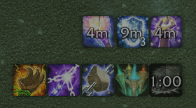
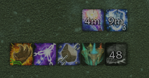
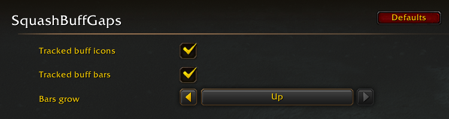

# SquashBuffGaps

Closes the empty slots between shown tracked buffs in the game's Cooldown Manager when
"Hide when inactive" is on, for buff icons and buff bars.

## Features

- **Buff icons** - shown icons move together against the edge their Edit Mode direction
  points to; hidden ones leave no gap.
- **Buff bars** - shown bars move together; hidden ones leave no gap.
- **Bar growth** - choose whether buff bars stack downward or upward.
- **Fixed edges** - icons and bars stay inside the area Edit Mode shows, however many are
  active.
- **Follows your layout** - orientation and icon direction from Edit Mode decide the edge
  items pack against, in the order set in the Cooldown Manager.
- **Remembered** - the settings are saved per account; default is off.
- **Totem fix** - out of combat, tracked totems that are no longer out disappear, even
  when the game leaves them on screen with a frozen timer; always on.
- **Edit Mode panel** - selecting Tracked Buffs or Tracked Bars in Edit Mode shows the
  options right below Blizzard's settings dialog.
- **Settings page** - all options in the game menu under Options > AddOns, also opened
  from the addon compartment menu.
- **Chat commands** - every option can also be changed by slash command.

## Screenshots

All tracked buffs active, then one expired: the others close the gap against the right edge.




Settings page under Options > AddOns:



## Install

1. Download `SquashBuffGaps-vX.Y.Z.zip` from the
   [releases](https://github.com/tf4482/SquashBuffGaps/releases) or CurseForge.
2. Unzip it into `World of Warcraft/<game folder>/Interface/AddOns/`.
3. Restart the game or type `/reload`.

## Usage

```text
/sbg              show the current state
/sbg icons on|off close gaps between tracked buff icons
/sbg bars on|off  close gaps between tracked buff bars
/sbg grow down|up direction buff bars stack in
/sbg config       open the settings page
/sbg help         list all commands
```

## Examples

- Icon direction Right, buffs 1 and 3 of 4 active: `/sbg icons on` puts both at the right
  edge, buff 1 directly left of buff 3.
- Icon direction Left: the same buffs pack against the left edge instead.
- Vertical bars: `/sbg bars on` stacks the active bars without holes from the start edge.
- Bars anchored above the player frame: `/sbg grow up` stacks them upward from the bottom.
- In Edit Mode: click Tracked Bars, tick "Close Gaps" below the dialog and pick "Up".
- Totemic Recall leaves some totems on screen: out of combat they disappear on their own.
- Back to the game's own spacing: `/sbg icons off` and `/sbg bars off`.

## Develop

Check the code with [Luacheck](https://github.com/lunarmodules/luacheck) before each commit
(CI runs it on every push):

```text
luacheck .
```

Release: push an annotated tag `vX.Y.Z`; GitHub Actions packages the addon with the
BigWigs packager and publishes it.

## License

All rights reserved, see [LICENSE](LICENSE).
